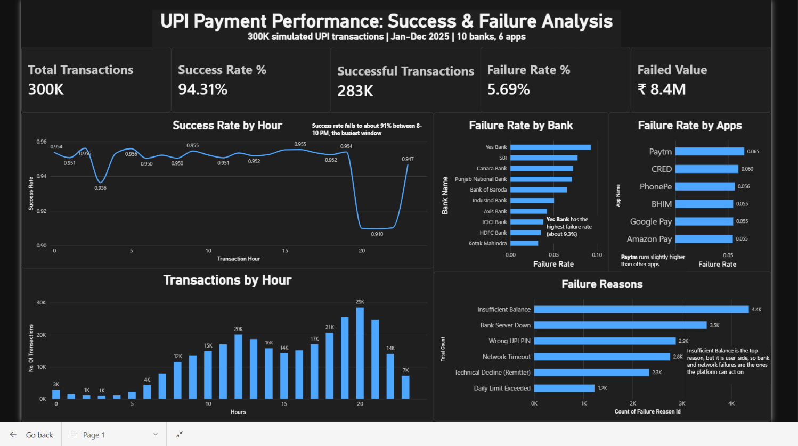

# UPI Payments Success Rate Dashboard

Power BI dashboard analyzing **300K simulated UPI transactions** to find when, where, and why payments fail.

## Business Questions
- How healthy is the payment system overall?
- When do failures spike, and which banks and apps fail most?
- What are the most common failure reasons, and which can the platform fix?

## Data
The dataset is **synthetic**, generated in Python and modeled on UPI usage patterns and publicly reported NPCI statistics. It covers Jan-Dec 2025, 10 banks and 6 apps.

Star schema: `fact_transactions` (300K rows) plus `dim_bank`, `dim_app`, `dim_date`, `dim_failure_reason`.

## Tools
MySQL, Power BI, DAX

## Approach
1. Loaded the data into MySQL and checked the row counts
2. Wrote SQL queries to find the patterns (`your_sql_file.sql`)
3. Modeled the tables as a star schema in Power BI
4. Wrote DAX measures (Success Rate, Failure Rate, Failed Value) and validated them against the SQL results

## Key Insights
- Overall success rate is **94.31%**, and failed transaction value is about **₹8.4M**
- Success drops to about **91% between 8-10 PM**, the busiest window, against about 95% in other hours
- **Yes Bank** has the highest failure rate (about 9.3%)
- **Paytm** has a slightly lower success rate than other apps (93.46%)
- **Insufficient Balance** is the top failure reason, but it is user-side. Bank and network failures are the ones the platform can act on.

## Recommendations
- Add capacity or retry handling for the 8-10 PM window
- Review the performance of the highest-failure banks
- Track bank and network failures separately from user-side failures

## Files
- `fact_transactions.csv`, `dim_*.csv`: the dataset
- `sql`: SQL analysis queries
- `upi_dashboard_ss.png`: dashboard screenshot
- `upi_success_rate_dash.pbix`: dashboard 
